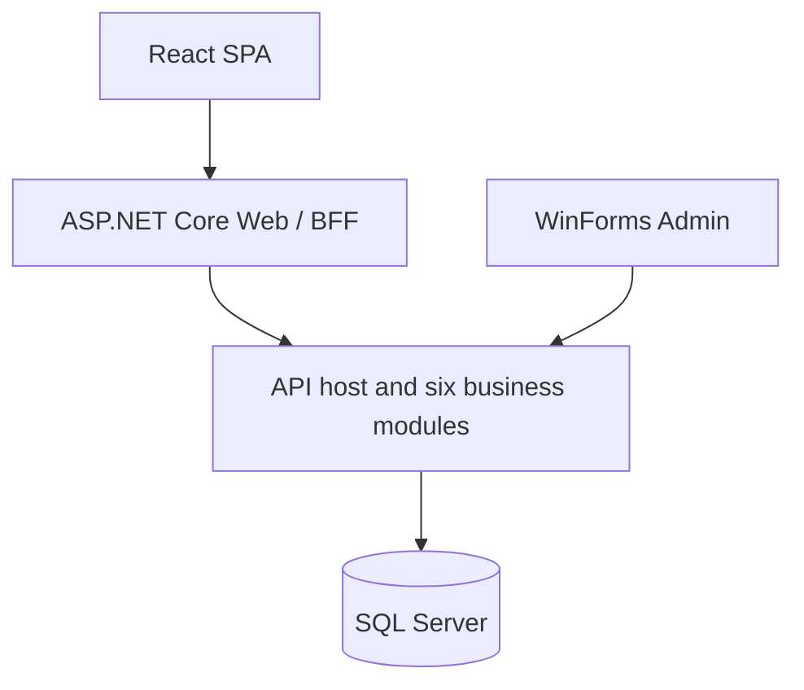

# DongNamTrip

> Tour discovery and trip management for Southeast Vietnam (Đông Nam Bộ).

[](https://github.com/K-sewii/tour-booking-management-system/actions/workflows/build.yml)
[](https://github.com/K-sewii/tour-booking-management-system/actions/workflows/docker.yml)

**Tiếng Việt: [README.vi.md](README.vi.md)**

DongNamTrip is a university project. Customers use a React single-page application; staff use a Windows Forms admin application. Both access an ASP.NET Core API backed by SQL Server.

**Status: under development.** Catalog and personal itinerary data use SQL Server. The project does not yet provide a complete booking, payment collection or refund workflow. Only the `Development` environment is currently supported.

## Architecture



The API is a modular monolith: one deployable application with six business modules. Module code follows:

`Presentation → BusinessLogic → DataAccess`

Cross-module calls use public `I*Api` ports. Persistence currently uses a shared DbContext and entities; separate module schemas are not implemented.

See [ADR-001](docs/architecture/ADR-001-modular-monolith.md).

| Module | Subsystem | Current scope |
| --- | --- | --- |
| Catalog | PH1 | SQL catalog, destination/tour search and details, reference estimates, destination administration, activities and activity slots |
| Itinerary | PH2 | SQL personal itineraries, ordered stops, desired activity slots, editing and schedule warnings |
| Booking | PH3 | Account-owned order/transaction history and saved payment preference; no complete booking/payment/refund workflow |
| Quotation | PH4 | Private-tour requests, service verification, quotes and accepting a current quote into a pending order |
| Narration | PH5 | Narration editing, versions, translations, audio upload, publication status, authenticated listening and listen-right management |
| Administration | PH6 | SQL accounts, roles, account area, in-memory API sessions and audit support |

The Web application is a backend-for-frontend (BFF). It serves the SPA, maintains the browser session through an HttpOnly cookie, protects writes with antiforgery and forwards requests to the API.

The SPA does not store API tokens in `localStorage` or `sessionStorage`. Authorization and data-ownership checks remain in the API.

Search, paging, totals, estimates and validation limits come from the backend, including `GET /api/meta`.

## Technology

| Layer | Technology |
| --- | --- |
| Frontend | React, TypeScript, Vite, React Router |
| BFF | ASP.NET Core (.NET 10) |
| API | ASP.NET Core Minimal APIs, Entity Framework Core 10 |
| Admin | Windows Forms (.NET 10, Windows only) |
| Database | SQL Server; Docker uses SQL Server 2022 |
| API documentation | Microsoft.AspNetCore.OpenApi and Swagger UI |
| Testing | ESLint, Vitest, Python integration runners, Playwright |
| Automation | Docker Compose, GitHub Actions, Dependabot |

## Prerequisites

For Docker:

- Docker Desktop with the Linux engine running, or a compatible Docker Engine.
- Docker Compose.
- Repository SQL scripts and a configured `.env`.

For running applications directly on Windows:

- .NET SDK matching `global.json`.
- Node.js/npm compatible with the SPA package configuration; the Docker frontend build uses Node 22.
- SQL Server and an initialized development database.
- Python for integration tests.
- Playwright and Chromium for browser tests.

WinForms runs directly on Windows, including when API/Web/SQL run in Docker.

## Database

Initialization scripts are maintained in `db/init/`:

1. `DongNamTrip_Full.sql`: base schema, roles, languages, development accounts and sample catalog.
2. `V001_account_area.sql`: favorites, activity, notices and preferences.
3. `V002_payment_choice.sql`: payment-method preference.

Use full initialization only for a new development database. Do not rerun the full script against an existing database or generate schema changes automatically from EF entities.

Public catalog results depend on publication status. Seeded tours may remain `Draft` and therefore not appear publicly.

For an existing database, apply future schema changes through an explicit, reviewed migration procedure. Restarting Docker does not automatically migrate an existing database.

## Running with Docker

Run from the repository root in PowerShell:

```powershell
git clone https://github.com/K-sewii/tour-booking-management-system.git
Set-Location .\tour-booking-management-system

if (-not (Test-Path .env)) {
    Copy-Item .env.example .env
}
```

Edit `.env` and configure `MSSQL_SA_PASSWORD` before starting:

```powershell
docker compose up -d --build
docker compose ps -a
```

| Service | Host address | Internal Docker address |
| --- | --- | --- |
| Web | http://localhost:5081 | web:8080 |
| API | http://localhost:5080 | api:8080 |
| SQL Server | localhost,14330 | db:1433 |

The SQL mapping in `docker-compose.yml` must match:

```yaml
ports:
  - "127.0.0.1:14330:1433"
```

The API connection string inside Docker uses `Server=db`; keep the internal SQL port at 1433.

### Startup behavior

- `db` stores SQL data in the persistent `sqldata` volume.
- `db-init` runs initialization scripts when the database does not exist.
- If the database already exists, initialization is skipped.
- `db-init` ending with `Exited (0)` is normal.
- API starts after successful initialization.
- Web starts after API becomes healthy.

Keep `db/init.sh` in UTF-8 without BOM and with LF line endings. Add this rule to `.gitattributes`:

```gitattributes
db/init.sh text eol=lf
```

Check SQL connectivity:

```powershell
Invoke-RestMethod http://localhost:5080/health/db
```

View recent logs:

```powershell
docker compose logs --no-color --tail=100 api web db-init
```

After source changes:

```powershell
docker compose up -d --build api web
```

After runtime configuration changes only:

```powershell
docker compose up -d api web
```

Do not use `docker compose down -v` as a routine troubleshooting step: it removes the Compose volumes, including database storage.

Local Docker startup has been verified. This is not a claim that every regression test or production deployment has passed.

## Running directly on Windows

Use this as an alternative to running API/Web in Docker. Do not start both on the same host ports.

From the repository root:

```powershell
dotnet restore .\DongNamTrip.sln
dotnet build .\DongNamTrip.sln --no-restore
```

Build the SPA while preserving the current directory:

```powershell
Push-Location .\src\Frontend\DongNamTrip.Spa
try {
    npm ci
    npm run build
}
finally {
    Pop-Location
}
```

The frontend output is written to:

`src/Frontend/DongNamTrip.Web/wwwroot/spa`

Configure the API connection string for your SQL instance. This example assumes a local `SQLEXPRESS` instance and an existing database:

```powershell
dotnet user-secrets set "ConnectionStrings:DongNamTrip" "Server=.\SQLEXPRESS;Database=DongNamTrip;Integrated Security=True;Encrypt=True;TrustServerCertificate=True;" --project .\src\Backend\DongNamTrip.Api
```

Start each application in a separate terminal from the repository root.

API:

```powershell
$env:ASPNETCORE_ENVIRONMENT = "Development"
dotnet run --project .\src\Backend\DongNamTrip.Api --launch-profile http
```

Web:

```powershell
$env:ASPNETCORE_ENVIRONMENT = "Development"
dotnet run --project .\src\Frontend\DongNamTrip.Web --launch-profile http
```

WinForms:

```powershell
dotnet run --project .\src\Frontend\DongNamTrip.Admin
```

For frontend hot reload, keep API and Web running, then use another terminal:

```powershell
Set-Location .\src\Frontend\DongNamTrip.Spa
npm run dev
```

Open `http://127.0.0.1:5173`.

Legacy MVC remains available through `?legacy=1` or `Spa__Enabled=false`.

## OpenAPI and Swagger

Development URLs:

- [Swagger UI](http://localhost:5080/swagger)
- [OpenAPI JSON](http://localhost:5080/openapi/v1.json)

The native ASP.NET Core OpenAPI generator produces the document; Swagger UI renders it.

To call protected endpoints:

1. Call `POST /api/auth/login` using a development account.
2. Copy the returned session token.
3. Select **Authorize** and paste only the token.
4. Execute the protected request.

Swagger sends `Authorization: Bearer <token>`.

The token is an opaque session token, not a JWT. API sessions are stored in memory, expire according to configuration and are lost when the API restarts. Swagger authorization persistence is not enabled.

Public endpoints do not require a token. Protected operations enforce their actual roles and ownership rules in the API; Swagger descriptions do not replace those checks.

Do not include real passwords or tokens in examples, screenshots or commits.

## Configuration

| Setting | Application | Purpose |
| --- | --- | --- |
| `ConnectionStrings:DongNamTrip` | API | SQL connection; User Secrets for host execution or `ConnectionStrings__DongNamTrip` in environment configuration |
| `ApiBaseUrl` | Web | API address; Docker uses `http://api:8080/` |
| `Spa:Enabled` | Web | Set to `false` for legacy MVC |
| `BootstrapAdmin:Enabled/Name/Email/Password` | API | Optional development admin bootstrap |
| `DevelopmentTestAccounts:Enabled` | API | Optional development account seeding |
| `MSSQL_SA_PASSWORD` | Docker `.env` | SQL Server administrator password |
| `DONGNAMTRIP_API_URL` | WinForms | Override the API address |

Host User Secrets are not automatically available inside Docker containers.

Never commit `.env`, actual connection credentials or session tokens.

### Development accounts

The base SQL script seeds these accounts:

| Email | Role |
| --- | --- |
| admin@dongnamtrip.test | Admin |
| operator@dongnamtrip.test | Operator |
| editor@dongnamtrip.test | Editor |
| finance@dongnamtrip.test | Finance |
| publisher@dongnamtrip.test | Publisher |
| customer1@dongnamtrip.test | Customer |
| customer2@dongnamtrip.test | Customer |

Their initial development-only password in the supplied seed script is `DntTest@2026!`. Existing databases may have different passwords if they were changed.

Public registration creates only `Customer`. WinForms accepts staff roles only.

## Testing

Frontend checks:

```powershell
Push-Location .\src\Frontend\DongNamTrip.Spa
try {
    npm run lint
    npm test
    npm run build
}
finally {
    Pop-Location
}
```

Architecture and integration runners, from the repository root:

```powershell
python tests/architecture/rules.py
python .\tests\api\smoke.py --start
python .\tests\api\auth_screens.py --start
python .\tests\api\content_screens.py --start
python .\tests\e2e\browser_runner.py
python .\tests\spa\spa_runner.py
python .\tests\spa\vite_hmr_runner.py
```

- Inspect each runner's prerequisites and arguments.
- Integration tests use real SQL Server and may create temporary accounts and records.
- Use an isolated development/test database.
- Run suites sequentially unless database and port isolation is explicitly configured.
- Check for occupied ports before using runners that start API/Web processes.
- Browser tests require Playwright and Chromium.
- Clean up only data created by the test.
- A successful build or health check is not a full regression test.
- WinForms build validation does not establish that its GUI has been tested.

## CI/CD

| Workflow | Purpose |
| --- | --- |
| `build.yml` | Frontend checks/build/audit, .NET build, architecture rules and integration/browser tests |
| `docker.yml` | Compose validation, image builds, security scanning, smoke tests and configured GHCR publishing |
| Dependabot | Dependency update proposals |

CI database tests use repository SQL scripts and a CI catalog fixture to prepare an isolated Windows LocalDB database. The schema is not supplied through a repository secret.

See `.github/workflows/` for exact triggers, publishing conditions and current checks. A badge or previous run does not establish that a new commit passed.

## Project structure

| Directory | Purpose |
| --- | --- |
| `src/Backend/DongNamTrip.Api` | API host, configuration, health and OpenAPI |
| `src/Backend/DongNamTrip.Modules` | Six business modules and shared persistence |
| `src/Frontend/DongNamTrip.Spa` | React SPA organized by feature |
| `src/Frontend/DongNamTrip.Web` | BFF, SPA hosting and legacy MVC |
| `src/Frontend/DongNamTrip.Admin` | WinForms staff application |
| `src/Frontend/DongNamTrip.Client` | Shared .NET HTTP client |
| `src/Shared/DongNamTrip.Contracts` | Shared DTOs and vocabulary |
| `tests/architecture` | Static module/layer checks |
| `tests/api` | HTTP/SQL integration tests |
| `tests/e2e` | Browser tests |
| `tests/spa` | SPA, fault and HMR tests |
| `tests/ci` | CI helpers |
| `db` | Initialization script and SQL files |
| `docs` | Architecture decisions and design documents |

Generated directories such as `bin`, `obj`, `node_modules` and the SPA build output must not be committed.

## Web screens

| Path | Screen |
| --- | --- |
| `/` | Home |
| `/Tours`, `/Tours/Details/{id}` | Tour listing and details |
| `/Destinations`, `/Destinations/Details/{id}` | Destination listing and details |
| `/Planner`, `/Trips` | Itinerary planner and personal trips |
| `/Account/Login`, `/Account/Register` | SCR02 login and SCR03 registration |
| `/Account/Profile` | SCR21 profile |
| `/Account/Security` | SCR22 password and sessions |
| `/Account/Payments` | SCR23 recorded orders/transactions and payment preference |
| `/Account/Favorites` | SCR24 favorites and history |
| `/Account/Notices` | SCR25 notices and preferences |

Narration also provides authenticated listening functionality. Staff content management is available through the corresponding WinForms screens and API endpoints.

The payment screen does not implement actual payment collection or refunds.

## Troubleshooting

| Symptom | Action |
| --- | --- |
| Docker cannot connect to `dockerDesktopLinuxEngine` | Start Docker Desktop and wait for the Linux engine |
| SQL host port cannot bind | Check that the host mapping uses an available port; this setup uses `14330:1433` |
| `init.sh`: `set: pipefail` invalid option | Check LF line endings and UTF-8 without BOM |
| `db-init` exits with code 0 | Normal: initialization finished or the database already exists |
| `db-init` exits with a nonzero code | Read its latest logs before modifying SQL or rerunning initialization |
| Initialization is skipped | Check whether the database already exists or SQL scripts are missing |
| `/health/db` fails | Check SQL readiness, database name and connection configuration |
| Web reports missing SPA build | Run `npm ci` and `npm run build` in the SPA directory |
| Swagger omits recent changes | Rebuild/restart the API serving the current source |
| DLL/EXE locked during build | Stop the specific process holding the files, then rebuild |
| Customer cannot sign in to WinForms | WinForms requires a staff role |
| New initialization script is not applied | Existing databases are skipped; prepare an explicit migration procedure |

## Contributing

1. Create a `feature/<short-name>` branch from the appropriate current base.
2. Preserve existing local changes before updating or merging.
3. Follow module boundaries and read the relevant `CLAUDE.md`.
4. Keep API contracts compatible with Web and WinForms.
5. Build and run tests relevant to the change.
6. Update documentation to match actual behavior.
7. Stage explicit files and exclude credentials/generated output.
8. Open a pull request and check CI results before merging.

## License

No license is declared in this README. Consult the repository's current license files and project owners before redistribution.
