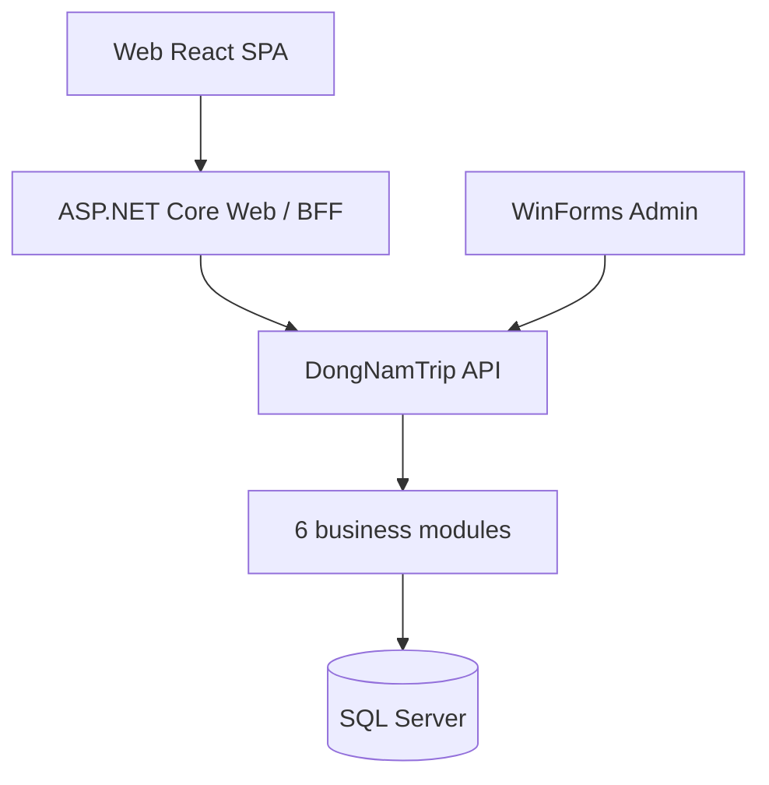

# DongNamTrip

> Tour discovery and trip management for Southeast Vietnam (Đông Nam Bộ).

[](https://github.com/K-sewii/tour-booking-management-system/actions/workflows/build.yml)
[](https://github.com/K-sewii/tour-booking-management-system/actions/workflows/docker.yml)

*Tiếng Việt: [README.vi.md](README.vi.md)*

DongNamTrip is a university project. Customers use a React single-page app; staff use a Windows Forms admin tool. Both talk to one ASP.NET Core API backed by SQL Server.

> **Status: under development.** Tours, destinations and itineraries are read from and written to SQL Server by the API; the database needs seed data (published rows) before the catalog shows anything. The frontends only call the API: search, paging, totals, estimates and validation limits (`GET /api/meta`) all come from the backend. There is no real booking flow or payment gateway yet. Only the `Development` environment is supported.

## Table of contents

- [Architecture](#architecture)
- [Tech stack](#tech-stack)
- [Getting started](#getting-started)
- [Running with Docker](#running-with-docker)
- [Running locally](#running-locally)
- [Configuration](#configuration)
- [Testing](#testing)
- [CI/CD](#cicd)
- [Project structure](#project-structure)
- [Screens](#screens)
- [Troubleshooting](#troubleshooting)
- [Contributing](#contributing)
- [License](#license)

## Architecture



The API is a **modular monolith**: one deployable, six business modules, each split into Presentation (UI), BusinessLogic and DataAccess layers, that own their endpoints and, over time, their data (see [ADR-001](docs/architecture/ADR-001-modular-monolith.md)).

| Module | Subsystem | Responsibility |
| --- | --- | --- |
| `Catalog` | PH1 | Destinations, activities, sessions |
| `Itinerary` | PH2 | Personal itineraries, private-tour requests |
| `Booking` | PH3 | Tours, departures, orders, payments |
| `Quotation` | PH4 | Service verification and quotes |
| `Narration` | PH5 | Multilingual narration and audio |
| `Administration` | PH6 | Accounts, roles, sessions, account area (SCR21–25), audit |

The Web project is a backend-for-frontend: it serves the SPA, keeps the login in an HttpOnly cookie, protects writes with antiforgery tokens and forwards calls to the API. The SPA never stores an API token in `localStorage` or `sessionStorage`; the API still enforces authorization and ownership.

## Tech stack

| Layer | Technology |
| --- | --- |
| Frontend | React 19, TypeScript, Vite, React Router |
| BFF | ASP.NET Core (.NET 10) |
| API | ASP.NET Core Minimal APIs, Entity Framework Core 10 |
| Admin | Windows Forms (.NET 10, Windows only) |
| Database | SQL Server |
| Tooling | Docker Compose, GitHub Actions, Dependabot, Playwright, Python test scripts |

## Getting started

### Prerequisites

| Tool | Version | Needed for |
| --- | --- | --- |
| Docker + Compose v2 | recent | Docker path |
| .NET SDK | 10 (see `global.json`) | Local path |
| Node.js / npm | 22.12+ / 10 | Local path (SPA) |
| SQL Server | any supported edition | Local path |
| Windows | 10+ | WinForms Admin only |

### Database schema

The schema and sample data live in `db/init/` and are used as-is by Docker, CI and deployment. Scripts run in file-name order:

1. `DongNamTrip_Full.sql` – base schema (25 tables), roles, languages, test accounts, sample catalog
2. `V001_account_area.sql` – favorites, activity, notices, preferences
3. `V002_payment_choice.sql` – payment method choice

Run the init scripts only on a new database. Do not re-run them on a database that has data, and do not generate the schema from the EF entities.

## Running with Docker

```bash
git clone https://github.com/K-sewii/tour-booking-management-system.git
cd tour-booking-management-system

cp .env.example .env            # set MSSQL_SA_PASSWORD
docker compose up --build
```

| Service | URL |
| --- | --- |
| Web (SPA + BFF) | http://localhost:5081 |
| API | http://localhost:5080 (`/health`, `/health/db`) |
| SQL Server | `127.0.0.1:1433` (user `sa`) |

How it works:

- `db` is SQL Server 2022 with a persistent volume.
- `db-init` creates the `DongNamTrip` database from `db/init/*.sql` (schema and data supplied by the team), only if the database does not exist, then exits. Catalog rows must have `TrangThai = 'Published'` (statuses: `Draft`, `Published`, `Inactive`). To start over: `docker compose down -v`.
- `api` and `web` are built from `src/Backend/DongNamTrip.Api/Dockerfile` and `src/Frontend/DongNamTrip.Web/Dockerfile` (multi-stage, non-root; the Web image also builds the SPA).
- Without any `.sql` file in `db/init/`, the stack starts but anything needing SQL fails.
- The WinForms Admin runs on the Windows host and points at `http://localhost:5080/` (`DONGNAMTRIP_API_URL` to override).

> The Docker setup has not yet been run on a developer machine; the `docker.yml` workflow builds, scans and smoke-tests the images on every push.

## Running locally

```powershell
dotnet restore .\DongNamTrip.sln
dotnet build .\DongNamTrip.sln --no-restore

# SPA (output goes to src/Frontend/DongNamTrip.Web/wwwroot/spa, not committed)
cd .\src\Frontend\DongNamTrip.Spa; npm ci; npm run build; cd ..\..

# Connection string, once per machine
dotnet user-secrets set "ConnectionStrings:DongNamTrip" "Server=.\SQLEXPRESS;Database=DongNamTrip;Integrated Security=True;Encrypt=True;TrustServerCertificate=True;" --project .\src\Backend\DongNamTrip.Api
```

Start each in its own terminal, API first:

```powershell
$env:ASPNETCORE_ENVIRONMENT = "Development"
dotnet run --project .\src\Backend\DongNamTrip.Api --launch-profile http   # http://localhost:5080
dotnet run --project .\src\Frontend\DongNamTrip.Web --launch-profile http   # http://localhost:5081
dotnet run --project .\src\Frontend\DongNamTrip.Admin                       # WinForms
```

For frontend work with hot reload, keep API and Web running and run `npm run dev` in `src/Frontend/DongNamTrip.Spa`, then open http://127.0.0.1:5173. The legacy MVC pages stay available with `?legacy=1` or `Spa__Enabled=false`.

## Configuration

| Setting | Where | Purpose |
| --- | --- | --- |
| `ConnectionStrings:DongNamTrip` | API (User Secrets / env `ConnectionStrings__DongNamTrip`) | SQL Server connection |
| `ApiBaseUrl` | Web | API address (default `http://localhost:5080/`) |
| `Spa:Enabled` | Web | `false` serves the legacy MVC views |
| `BootstrapAdmin:Enabled/Name/Email/Password` | API | Optional first admin; created only if the email is new |
| `DevelopmentTestAccounts:Enabled` | API | Optional seeded dev accounts |
| `MSSQL_SA_PASSWORD` | `.env` (Docker) | SQL Server `sa` password; avoid `;` and `=` |
| `DONGNAMTRIP_API_URL` | Admin | API address |

Never commit connection strings, passwords, tokens or `.env`. Public registration always creates a `Customer`; staff roles are `Admin`, `Operator`, `Editor`, `Finance`, `Publisher`.

### Test accounts already in the database

If the database was created from `db/init/DongNamTrip_Full.sql`, the script already seeds seven test accounts that **share the initial password `DntTest@2026!`**. No extra configuration is needed to sign in. Development databases only.

| Email | Role |
| --- | --- |
| `admin@dongnamtrip.test` | Admin |
| `operator@dongnamtrip.test` | Operator |
| `editor@dongnamtrip.test` | Editor |
| `finance@dongnamtrip.test` | Finance |
| `publisher@dongnamtrip.test` | Publisher |
| `customer1@dongnamtrip.test` | Customer |
| `customer2@dongnamtrip.test` | Customer |

The WinForms Admin accepts staff roles only (not Customer). If a password was changed in the database, or the database was not created from this script, the password will differ.

## Testing

Tests run against a real API and SQL Server **development** database and may create and clean up temporary accounts. Do not run them against production data.

```powershell
python tests/architecture/rules.py   # module/layer rules, no database needed
python .\tests\api\smoke.py --start
python .\tests\api\auth_screens.py --start
python .\tests\e2e\browser_runner.py
python .\tests\spa\spa_runner.py
python .\tests\spa\vite_hmr_runner.py
```

Browser tests need Playwright and Chromium. The WinForms GUI is built in CI but not covered by automated GUI tests.

## CI/CD

| Workflow | Trigger | What it does |
| --- | --- | --- |
| `build.yml` | push, PR | SPA type-check, build and `npm audit`; solution build; API/Web smoke, auth and browser tests on Windows with LocalDB |
| `docker.yml` | push to `main`, `v*` tags, PRs touching `src/`, Docker or DB files | Validates compose; builds API and Web images; Trivy scan (fails on fixable CRITICAL); runs each image and checks HTTP 200; pushes to GHCR on `main` and tags |
| Dependabot | weekly | NuGet, npm, GitHub Actions, Docker base images |

Published images: `ghcr.io/k-sewii/tour-booking-management-system-api` and `...-web`, tagged by branch, semver tag and short SHA. There is no automatic deployment target yet; images are published for a future environment. The `build.yml` database tests build a LocalDB from `db/init/*.sql`; no repository secrets are needed.

## Project structure

```text
.
├── src/
│   ├── Frontend/
│   │   ├── DongNamTrip.Spa/        React + TypeScript SPA (feature folders)
│   │   ├── DongNamTrip.Web/        BFF: serves SPA, cookie session, proxies to API; legacy MVC views
│   │   ├── DongNamTrip.Admin/      WinForms admin
│   │   └── DongNamTrip.Client/     HTTP client for the API (used by Web and Admin)
│   ├── Backend/
│   │   ├── DongNamTrip.Api/        Thin host (Program.cs)
│   │   └── DongNamTrip.Modules/    Catalog, Itinerary, Booking, Quotation, Narration, Administration
│   │       └── <Module>/           Presentation (UI) / BusinessLogic / DataAccess
│   └── Shared/
│       └── DongNamTrip.Contracts/  Shared DTOs
├── tests/
│   ├── architecture/           module and layer rules (no database)
│   ├── api/                    HTTP + SQL integration tests and shared harness
│   ├── e2e/                    Playwright browser tests
│   ├── spa/                    SPA, fault-injection and Vite HMR tests
│   └── ci/                     CI helper scripts
├── db/                         Docker DB init (init.sh; init/*.sql = schema + data)
├── docs/                       Design diagrams, ADRs (docs/architecture)
├── docker-compose.yml
└── .github/                    Workflows, Dependabot
```

## Screens

| Path | Screen |
| --- | --- |
| `/` | Home |
| `/Tours`, `/Tours/Details/{id}` | Tours |
| `/Destinations`, `/Destinations/Details/{id}` | Destinations |
| `/Planner`, `/Trips` | Itinerary planner, my trips |
| `/Account/Login`, `/Account/Register` | SCR02 sign in, SCR03 sign up |
| `/Account/Profile` | SCR21 profile |
| `/Account/Security` | SCR22 password and sessions |
| `/Account/Payments` | SCR23 payments and refunds |
| `/Account/Favorites` | SCR24 favorites and history |
| `/Account/Notices` | SCR25 notices and preferences |

## Troubleshooting

| Symptom | Check |
| --- | --- |
| API: "ConnectionStrings:DongNamTrip must be configured" | User Secrets of the API project, or `.env` in Docker |
| `/health/db` fails | SQL Server running, instance/database name, credentials |
| Web says SPA build is missing | Run `npm ci && npm run build` in `src/Frontend/DongNamTrip.Spa` |
| Web or Admin cannot reach the API | Start the API first; check `/health` and `ApiBaseUrl` |
| `db-init` skipped | No `.sql` files in `db/init/` |
| DLL/EXE locked on build | Stop the running app, then rebuild |
| A Customer cannot sign in to Admin | WinForms is for staff roles only |

## Contributing

1. Branch from `main` (`feature/<short-name>`).
2. Keep changes within one module where possible; modules must not reference each other's internals (see ADR-001).
3. Make sure the solution builds and the SPA builds; run the relevant tests.
4. Open a pull request; CI must pass.

## License

No license has been specified yet. All rights reserved by the authors until one is added.
