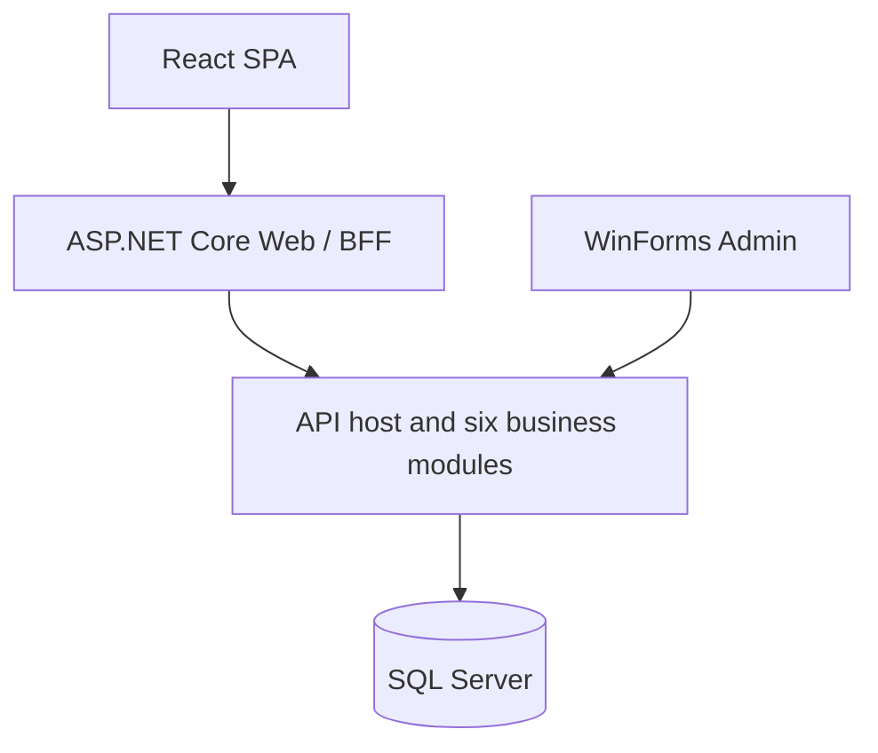

<div align="center">

# DongNamTrip

**Tour discovery and trip management for Southeast Vietnam (Đông Nam Bộ).**

[English](README.md) · [Tiếng Việt](README.vi.md)

[](https://github.com/K-sewii/tour-booking-management-system/actions/workflows/build.yml)
[](https://github.com/K-sewii/tour-booking-management-system/actions/workflows/docker.yml)
[](https://deepwiki.com/K-sewii/tour-booking-management-system)


[](https://gitdiagram.com/k-sewii/tour-booking-management-system?utm_source=readme&utm_medium=badge)


</div>

> **Status: under development.** Not production-ready: there is no complete booking, payment collection or refund workflow, and only the `Development` environment is supported.

DongNamTrip is a university project. Customers use a React single-page application; staff use a Windows Forms admin application. Both access an ASP.NET Core API backed by SQL Server.

## Table of contents

- [Features](#features)
- [Screenshots](#screenshots)
- [Quick start](#quick-start)
- [Architecture](#architecture)
- [Technology](#technology)
- [Documentation](#documentation)
- [Roadmap](#roadmap)
- [Contributing](#contributing)
- [Security](#security)
- [License](#license)

## Features

- **Catalog:** SQL-backed destination and tour search, details, reference estimates, activities and activity slots.
- **Itinerary:** personal itineraries with ordered stops, desired activity slots, editing and schedule warnings.
- **Booking:** account-owned order/transaction history and saved payment preference.
- **Quotation:** private-tour requests, service verification, quotes, and accepting a current quote into a pending order.
- **Narration:** editing, versions, translations, audio upload, publication status, authenticated listening and listen-right management.
- **Administration:** accounts, roles, account area, API sessions and audit support.
- **Security by design:** HttpOnly cookie session through the BFF, antiforgery on writes, no API tokens in browser storage; authorization and ownership checks stay in the API.

## Screenshots

<!-- TODO: add screenshots or a short GIF of the Web SPA and the WinForms admin under docs/images/ and embed them here. -->


## Quick start

Requires Docker with the Linux engine. See [prerequisites](docs/guides/prerequisites.md) for running directly on Windows.

```powershell
git clone https://github.com/K-sewii/tour-booking-management-system.git
Set-Location .\tour-booking-management-system
Copy-Item .env.example .env      # then set MSSQL_SA_PASSWORD in .env
docker compose up -d --build
```

| Service | URL |
| --- | --- |
| Web | http://localhost:5081 |
| API | http://localhost:5080 |
| Swagger UI | http://localhost:5080/swagger |

Check the database connection with `Invoke-RestMethod http://localhost:5080/health/db`. Full details: [Running with Docker](docs/guides/running-with-docker.md).

## Architecture



The API is a modular monolith: one deployable application with six business modules (Catalog, Itinerary, Booking, Quotation, Narration, Administration). Module code follows `Presentation → BusinessLogic → DataAccess`; cross-module calls use public `I*Api` ports. Persistence currently uses a shared DbContext and entities; separate module schemas are not implemented.

The Web application is a backend-for-frontend (BFF): it serves the SPA, keeps the browser session in an HttpOnly cookie, protects writes with antiforgery and forwards requests to the API. Search, paging, totals, estimates and validation limits come from the backend (`GET /api/meta`).

See [ADR-001](docs/architecture/ADR-001-modular-monolith.md) and [project structure](docs/guides/project-structure.md).

## Technology

| Layer | Technology |
| --- | --- |
| Frontend | React, TypeScript, Vite, React Router |
| BFF | ASP.NET Core (.NET 10) |
| API | ASP.NET Core Minimal APIs, Entity Framework Core 10 |
| Admin | Windows Forms (.NET 10, Windows only) |
| Database | SQL Server; Docker uses SQL Server 2022 |
| API documentation | Microsoft.AspNetCore.OpenApi and Swagger UI |
| Testing | ESLint, Vitest, Python integration runners, Playwright |
| Automation | Docker Compose, GitHub Actions, Dependabot |

## Documentation

| Guide | Contents |
| --- | --- |
| [Prerequisites](docs/guides/prerequisites.md) | Tools needed for Docker and Windows setups |
| [Running with Docker](docs/guides/running-with-docker.md) | Compose workflow, startup behavior, logs |
| [Running on Windows](docs/guides/running-on-windows.md) | API, Web, WinForms and SPA hot reload |
| [Database](docs/guides/database.md) | Initialization scripts and migrations |
| [Configuration](docs/guides/configuration.md) | Settings and development accounts |
| [API and Swagger](docs/guides/api-and-swagger.md) | OpenAPI, authorization in Swagger |
| [Testing and CI](docs/guides/testing-and-ci.md) | Test runners, workflows |
| [Web screens](docs/guides/web-screens.md) | Routes and screens |
| [Troubleshooting](docs/guides/troubleshooting.md) | Common problems |
| [Project structure](docs/guides/project-structure.md) | Directory layout |
| [Design documents](docs/) | Report, use cases, state machines, C4 diagrams |

## Roadmap

- [ ] Complete booking, seat hold and payment collection workflow
- [ ] Refund handling
- [ ] Automatic listen-right grant after payment
- [ ] Separate persistence schema per module
- [ ] Support for non-Development environments

## Contributing

Contributions are welcome. Read [CONTRIBUTING.md](CONTRIBUTING.md) and the [Code of Conduct](CODE_OF_CONDUCT.md) first.

## Security

Do not report vulnerabilities in public issues. See [SECURITY.md](SECURITY.md).

## License

Released under the [MIT License](LICENSE).
