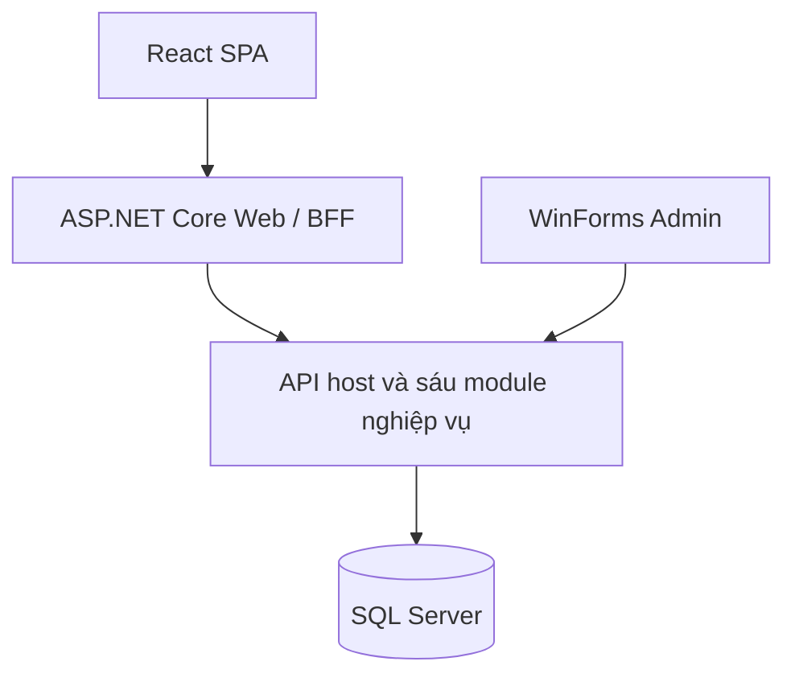

<div align="center">

# DongNamTrip

**Khám phá tour và quản lý hành trình khu vực Đông Nam Bộ.**

[English](README.md) · [Tiếng Việt](README.vi.md)

[](https://github.com/K-sewii/tour-booking-management-system/actions/workflows/build.yml)
[](https://github.com/K-sewii/tour-booking-management-system/actions/workflows/docker.yml)
[](https://deepwiki.com/K-sewii/tour-booking-management-system)


[](https://gitdiagram.com/k-sewii/tour-booking-management-system?utm_source=readme&utm_medium=badge)

</div>

> **Trạng thái: đang phát triển.** Chưa dùng cho production: chưa có luồng đặt tour, giữ chỗ, thanh toán thật hoặc hoàn tiền hoàn chỉnh; chỉ hỗ trợ môi trường `Development`.

DongNamTrip là dự án học tập. Khách hàng sử dụng Web React SPA; nhân viên sử dụng ứng dụng quản trị Windows Forms. Hai ứng dụng gọi chung API ASP.NET Core, API kết nối SQL Server.

## Mục lục

- [Tính năng](#tính-năng)
- [Ảnh chụp màn hình](#ảnh-chụp-màn-hình)
- [Bắt đầu nhanh](#bắt-đầu-nhanh)
- [Kiến trúc](#kiến-trúc)
- [Công nghệ](#công-nghệ)
- [Tài liệu](#tài-liệu)
- [Lộ trình](#lộ-trình)
- [Đóng góp](#đóng-góp)
- [Bảo mật](#bảo-mật)
- [Giấy phép](#giấy-phép)

## Tính năng

- **Catalog:** tìm kiếm và xem chi tiết điểm đến, tour từ SQL Server; ước tính tham khảo, hoạt động và khung giờ hoạt động.
- **Itinerary:** lịch trình cá nhân với các điểm dừng có thứ tự, khung giờ hoạt động mong muốn, chỉnh sửa và cảnh báo lịch.
- **Booking:** lịch sử đơn/giao dịch của tài khoản và lựa chọn thanh toán đã lưu.
- **Quotation:** yêu cầu tour riêng, xác minh dịch vụ, báo giá và chấp nhận báo giá hiện hành thành đơn chờ xử lý.
- **Narration:** biên tập thuyết minh, phiên bản, bản dịch, tải audio, trạng thái công bố, nghe có xác thực và quản lý quyền nghe.
- **Administration:** tài khoản, vai trò, khu vực tài khoản, phiên API và hỗ trợ audit.
- **Bảo mật:** phiên Web dùng cookie HttpOnly qua BFF, antiforgery cho thao tác ghi, không lưu API token trong trình duyệt; API kiểm tra quyền và quyền sở hữu dữ liệu.

## Ảnh chụp màn hình

<!-- TODO: thêm ảnh/GIF của Web SPA và WinForms Admin vào docs/images/ rồi nhúng tại đây. -->


## Bắt đầu nhanh

Cần Docker với Linux engine. Nếu chạy trực tiếp trên Windows, xem mục "Yêu cầu" trong [Hướng dẫn chi tiết](docs/guides/vi/huong-dan.md).

```powershell
git clone https://github.com/K-sewii/tour-booking-management-system.git
Set-Location .\tour-booking-management-system
Copy-Item .env.example .env      # rồi đặt MSSQL_SA_PASSWORD trong .env
docker compose up -d --build
```

| Dịch vụ | Địa chỉ |
| --- | --- |
| Web | http://localhost:5081 |
| API | http://localhost:5080 |
| Swagger UI | http://localhost:5080/swagger |

Chi tiết xem [Hướng dẫn chi tiết](docs/guides/vi/huong-dan.md) hoặc [Running with Docker](docs/guides/running-with-docker.md) (tiếng Anh).

## Kiến trúc



API là modular monolith: một ứng dụng triển khai duy nhất với 6 module nghiệp vụ (Catalog, Itinerary, Booking, Quotation, Narration, Administration), mỗi module có 3 lớp `Presentation → BusinessLogic → DataAccess`. Các module gọi nhau qua cổng công khai `I*Api`. Bảng SQL hiện còn dùng chung trong `Persistence`.

Web là lớp BFF: phục vụ SPA, giữ phiên bằng cookie HttpOnly, chống giả mạo bằng antiforgery và chuyển tiếp yêu cầu đến API.

Xem [ADR-001](docs/architecture/ADR-001-modular-monolith.md) và [cấu trúc dự án](docs/guides/project-structure.md).

## Công nghệ

| Tầng | Công nghệ |
| --- | --- |
| Frontend | React, TypeScript, Vite, React Router |
| BFF | ASP.NET Core (.NET 10) |
| API | ASP.NET Core Minimal APIs, Entity Framework Core 10 |
| Quản trị | Windows Forms (.NET 10, chỉ Windows) |
| Cơ sở dữ liệu | SQL Server; Docker dùng SQL Server 2022 |
| Tài liệu API | Microsoft.AspNetCore.OpenApi và Swagger UI |
| Kiểm thử | ESLint, Vitest, bộ chạy tích hợp Python, Playwright |
| Tự động hóa | Docker Compose, GitHub Actions, Dependabot |

## Tài liệu

- [Hướng dẫn chi tiết (tiếng Việt)](docs/guides/vi/huong-dan.md): yêu cầu, database, build và chạy, tài khoản, kiểm thử, xử lý lỗi.
- [Bộ hướng dẫn tiếng Anh](docs/guides/): Docker, Windows, database, cấu hình, API/Swagger, kiểm thử/CI.
- [Tài liệu thiết kế](docs/): báo cáo, use case, state machine, sơ đồ C4.

## Lộ trình

- [ ] Luồng đặt tour, giữ chỗ và thu thanh toán hoàn chỉnh
- [ ] Xử lý hoàn tiền
- [ ] Tự động cấp quyền nghe sau thanh toán
- [ ] Tách schema lưu trữ theo từng module
- [ ] Hỗ trợ môi trường ngoài Development

## Đóng góp

Hoan nghênh đóng góp. Đọc [CONTRIBUTING.md](CONTRIBUTING.md) và [Quy tắc ứng xử](CODE_OF_CONDUCT.md) trước.

## Bảo mật

Không báo lỗ hổng bảo mật qua issue công khai. Xem [SECURITY.md](SECURITY.md).

## Giấy phép

Phát hành theo [Giấy phép MIT](LICENSE).
