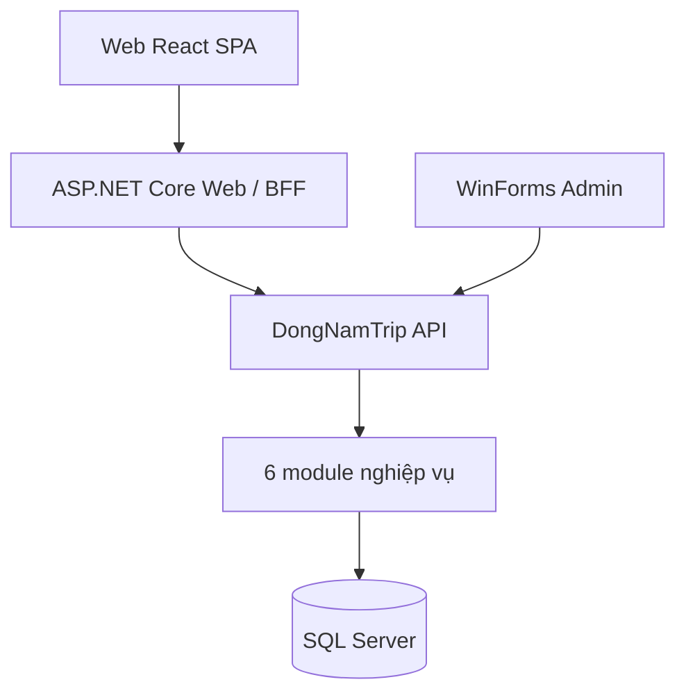
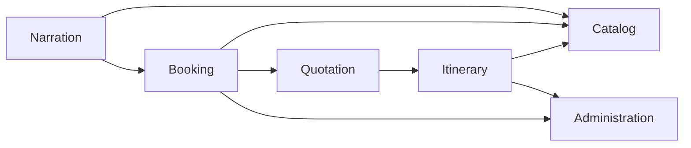

# ADR-001: Chuyển DongNamTrip.Api thành Modular Monolith gồm 6 module nghiệp vụ

## Status
Accepted — quyết định kiến trúc giữ nguyên. Tiến độ hiện tại ở mục riêng bên dưới: vẫn còn DbContext chung; Quotation và Narration chưa có endpoint/nghiệp vụ.

## Context (lịch sử khi ra quyết định)

Sơ đồ kiến trúc mục tiêu:



Ba tầng trên cùng (SPA → BFF → API, WinForms → API) **đã đúng với code hiện tại**. Phần chưa đúng là bên trong `DongNamTrip.Api`:

- `Program.cs` (~290 dòng) chứa toàn bộ endpoint của auth, tài khoản, danh mục, lịch trình; truy cập `DbContext` trực tiếp từ endpoint.
- Một `DongNamTripDbContext` duy nhất, một `Data/Entities` chung cho 25 bảng + 5 bảng khu tài khoản.
- Danh mục tour/điểm đến và lịch trình khi đó vẫn nằm trong `DemoStore` (bộ nhớ), chưa dùng SQL.
- Không có ranh giới module nên module này dễ chạm thẳng vào bảng của module khác.

Nguồn tham khảo: [kgrzybek/modular-monolith-with-ddd](https://github.com/kgrzybek/modular-monolith-with-ddd) (mỗi module độc lập, giao tiếp qua hợp đồng công khai/sự kiện, dữ liệu riêng theo module) và sơ đồ "schema từng mô-đun".

Sáu module lấy từ `docs/DongNamTrip_TongQuat_PhanHe.drawio` (PH1–PH6).

Ràng buộc: DB schema do nhóm cung cấp, README cấm tự tạo/đổi schema từ EF; URL `/api/...`, `DongNamTrip.Contracts`, Web BFF, Admin, SPA và test hiện có không được vỡ.

## Decision

### 1. Sáu module và dữ liệu sở hữu

| Module | Phân hệ | Use case | Bảng sở hữu |
| --- | --- | --- | --- |
| `Catalog` | PH1 Quản lý danh mục du lịch | UC03, UC04, UC14, UC15 | `DIADIEM`, `HOATDONG`, `SUAT` |
| `Itinerary` | PH2 Lịch trình cá nhân | UC05–UC09 | `LICHTRINH`, `LICHTRINH_DIADIEM`, `LICHTRINH_SUAT`, `PHIENBANLICHTRINH`, `YEUCAUTOURRIENG` |
| `Booking` | PH3 Tour và đơn đặt | UC02, UC10–UC13, UC16, UC20 | `TOUR`, `TOUR_DIADIEM`, `LICHKHOIHANH`, `DONDAT`, `GIAODICHTIEN`, `TAIKHOAN_THANHTOAN` |
| `Quotation` | PH4 Xác minh và báo giá | UC09–xác nhận, UC21–22 | `XACMINHDICHVU`, `BAOGIA`, `HANGMUCBAOGIA` |
| `Narration` | PH5 Thuyết minh đa ngôn ngữ | thuyết minh, dịch, TTS | `NGONNGU`, `THUYETMINH`, `BANDICH`, `TEPAUDIO`, `QUYENNGHE` |
| `Administration` | PH6 Quản trị hệ thống | UC01 + khu tài khoản SCR21–25 | `TAIKHOAN`, `VAITRO`, `TAIKHOAN_VAITRO`, `NHATKYTHAOTAC`, `TAIKHOAN_YEUTHICH/LICHSU/TUYCHON/THONGBAO`, phiên đăng nhập |

Ghi chú gán bảng (cần nhóm xác nhận): `QUYENNGHE` (quyền nghe, gắn đơn + tài khoản) đặt ở `Narration` vì là quyền truy cập nội dung; `GIAODICHTIEN` ở `Booking` theo sơ đồ PH3 (UC20); `NHATKYTHAOTAC` ghi từ mọi module nhưng sở hữu bởi `Administration`.

### 2. Cấu trúc thư mục

Ba thư mục cấp cao theo sơ đồ (Frontend → Backend, dùng chung Shared); mỗi module chia 3 lớp UI / Business Logic / Data Access:

```text
src/
├── Frontend/
│   ├── DongNamTrip.Spa/        React SPA
│   ├── DongNamTrip.Web/        BFF
│   ├── DongNamTrip.Admin/      WinForms
│   └── DongNamTrip.Client/     HTTP client gọi API (dùng bởi Web, Admin)
├── Backend/
│   ├── DongNamTrip.Api/        Host mỏng: Program.cs (cấu hình, rate limit, health, đăng ký + map module)
│   └── DongNamTrip.Modules/    1 project, mỗi module một thư mục
│       ├── IModule.cs, ModuleHttp.cs
│       ├── Persistence/        DongNamTripDbContext + Entities scaffold (dùng chung — nợ)
│       └── <Module>/           Catalog, Itinerary, Booking, Quotation, Narration, Administration
│           ├── <Module>Module.cs      điểm vào (DI), gọi Presentation
│           ├── Presentation/          UI: HTTP endpoint
│           ├── BusinessLogic/         nghiệp vụ, cổng công khai I*Api
│           └── DataAccess/            truy cập dữ liệu (EF mapping, repository)
└── Shared/
    └── DongNamTrip.Contracts/  DTO dùng chung
```

Các lớp trong một module dùng chung namespace `DongNamTrip.Modules.<Module>`; ranh giới lớp được kiểm bằng `tests/architecture/rules.py`, không bằng project riêng. Đây là quyết định ranh giới code; tiến độ triển khai thực tế ở mục “Tiến độ hiện tại”, không suy diễn từ mô tả lịch sử này.

### 3. Quy tắc phụ thuộc (kiểm bằng architecture test ở bước sau)

1. `Presentation` → `BusinessLogic` → `DataAccess` (chỉ đi xuống; `BusinessLogic`/`DataAccess` không dùng `*Endpoints`).
2. Module **không** tham chiếu project của module khác. Cần dữ liệu thì gọi một **port công khai** (`ICatalogApi.GetDestinationAsync(id)`) đặt trong `Contracts`/`BuildingBlocks`, hoặc nghe sự kiện nội bộ.
3. Entity của module khác chỉ được tham chiếu **bằng ID** (không navigation property xuyên module); xóa navigation `Dondat.MaTkNavigation → Taikhoan` v.v. khi chuyển từng module.
4. Mỗi module có `DbContext` riêng chỉ map bảng của mình; không `JOIN` xuyên module trong code — ghép dữ liệu ở lớp Application (hoặc read model).
5. Host chỉ gọi `IModule`; không chứa logic nghiệp vụ.

Phụ thuộc dự kiến giữa module (A → B nghĩa là A gọi cổng của B):



### 3b. Frontend chỉ gọi API

Backend sở hữu số liệu và luật; Frontend không khai báo danh mục hay giới hạn. Catalog và Itinerary đọc/ghi SQL (`DIADIEM`, `TOUR`, `TOUR_DIADIEM`, `LICHTRINH*`); `GET /api/meta` công bố khu vực, thể loại, cỡ trang và giới hạn nhập liệu (nguồn: `CatalogOptions` và `Limits` trong Contracts); tìm kiếm/phân trang/tổng/tạm tính tính ở API. `tests/architecture/rules.py` chặn tên khu vực gõ cứng và filter/sort/slice dữ liệu tour/điểm đến trong SPA. Còn lại: Admin (form điểm đến, dashboard) và trang chủ còn vài số liệu cứng (làm sau).

### 4. Mức độ DDD theo module (tránh over-engineering)

| Module | Mô hình | Lý do |
| --- | --- | --- |
| `Booking`, `Quotation` | Domain model giàu (aggregate `Dondat`, `Baogia`, state machine, giữ chỗ/hoàn tiền) | Có bất biến: sức chứa, hạn giữ chỗ, điều kiện hủy, trạng thái — xem `DongNamTrip_StateMachine.drawio` |
| `Itinerary` | Domain model vừa (phiên bản lịch trình) | Có versioning nhưng ít quy tắc |
| `Catalog`, `Narration`, `Administration` | Layered/CRUD đơn giản (Application + Infrastructure), `BusinessLogic` mỏng | Chủ yếu nhập liệu, ít bất biến; DDD ở đây là ceremony |

### 5. Dữ liệu: giữ một database, **chưa** tách schema

Sơ đồ tham khảo tách schema theo module (`product.`, `order.`). Với DongNamTrip, bước này cần script DBA đổi tên/chuyển bảng, mà schema do nhóm quản lý và CI dùng bản dump cố định. Quyết định: **giữ schema `dbo`**, ranh giới module được thực thi bằng code (DbContext riêng + quy tắc 2–4). Tách schema là bước độc lập sau (xem Consequences).

### 6. Giao tiếp

Đồng bộ trong tiến trình qua port công khai; sự kiện nội bộ (in-process, ví dụ `DonDatDaThanhToan` → `Narration` cấp `QUYENNGHE`, → `Administration` ghi nhật ký/thông báo) chỉ thêm khi có use case thật. Không dùng message broker.

## Options considered

| | A. Một project Modules, thư mục theo module (chọn) | B. 3–4 project/module như repo kgrzybek | C. Giữ nguyên, không chia |
| --- | --- | --- | --- |
| Ranh giới | Thư mục + architecture test | Compiler cấm Domain tham chiếu Infrastructure | Chỉ quy ước |
| Số project thêm | 0 | ~18–24 | 0 |
| Chi phí cho nhóm học tập | Thấp | Cao (csproj, reference, DI nhiều) | Rất thấp |
| Rủi ro | Domain có thể lỡ `using EF` → cần architecture test | Thấp | Ranh giới mất dần theo thời gian |
| Đảo ngược | Dễ tách thêm project khi cần | Khó gộp lại | Dễ |

Chọn A (một project `DongNamTrip.Modules`) vì ít thư mục nhất mà vẫn có ranh giới module; ranh giới được bảo vệ bằng architecture test thay vì project riêng. Khi cần, module có thể tách thành project mà không đổi API. Nếu một module (khả năng cao là `Booking`) phình to, nâng riêng module đó lên mô hình B.

## Consequences

**Dễ hơn**
- Mỗi người trong nhóm sở hữu một module, ít xung đột merge ở `Program.cs`.
- `DemoStore` thay dần bằng repository SQL theo từng module mà không động module khác.
- Có đường tách thành service sau này (module đã chỉ nói chuyện qua cổng).

**Khó hơn / đánh đổi**
- Thêm một lớp indirection (port, DbContext theo module); với CRUD đơn giản đây là chi phí thuần.
- Nhiều `DbContext` cùng trỏ một DB: không có transaction xuyên module "miễn phí"; thao tác nhiều module (đặt tour → giữ chỗ → ghi nhật ký) cần thiết kế rõ ràng (cùng connection/`TransactionScope` hoặc eventual consistency).
- FK vật lý trong DB vẫn nối các module; ranh giới chỉ do code giữ, nên review/architecture test là bắt buộc.
- Hiện mọi module còn dùng chung một `DongNamTripDbContext` (thư mục `Persistence`), nên quy tắc 4 chưa được thực thi; tách DbContext theo module là việc kế tiếp, cần chạy được test với SQL Server.
- `Administration` đang gộp Identity + khu Account; nếu phình to nên tách `Identity` và `Account` (ghi nhận là nợ kiến trúc, chưa làm).

## Tiến độ hiện tại (đối chiếu source cục bộ)

| Module | Đã có | Chưa có / giới hạn |
| --- | --- | --- |
| `Catalog` | Repository SQL cho `DIADIEM`, `TOUR`, `TOUR_DIADIEM`; danh sách/tìm kiếm/chi tiết/estimate và ghi điểm đến cho Admin/Editor | Chưa tách DbContext/schema; các bảng PH1 khác chưa có endpoint riêng |
| `Itinerary` | Repository SQL cho `LICHTRINH*`, preview công khai và danh sách/tạo lịch trình của tài khoản; đọc Catalog qua `ICatalogApi` | Chưa có các use case private-tour request/suất đầy đủ |
| `Booking` | Repository SQL đọc `DONDAT`/`GIAODICHTIEN` của chính tài khoản, và lưu lựa chọn `bank_transfer`/`cash` | Không tạo đơn, giữ chỗ, charge, refund hay cổng thanh toán; lựa chọn chỉ là preference |
| `Administration` | Xác thực SQL, tài khoản/khu vực tài khoản qua repository, role policy; `SqlSessionStore` giữ token Bearer trong bộ nhớ | `SqlAuthentication` vẫn truy cập DbContext trực tiếp và chưa tách repository |
| `Quotation` | Class module được host đăng ký | Không endpoint/service/repository |
| `Narration` | Class module được host đăng ký | Không endpoint/service/repository |

Catalog và Itinerary **không còn dùng `DemoStore`**. Mọi module vẫn dùng chung `DongNamTripDbContext`, nên quyết định đích “DbContext riêng” chưa hoàn thành. OpenAPI tích hợp hiện chỉ được map trong Development; Swagger UI đọc cùng tài liệu tích hợp, không phải một generator thứ hai.

## Migration plan (lịch sử và việc còn lại; mỗi bước build + test xanh, URL không đổi)

1. **(Đã làm)** Khung: `Api/Modules/IModule.cs` và 6 class module.
2. **(Đã làm)** Host: `Program.cs` gọi `IModule.Register/MapEndpoints` (module rỗng, không đổi hành vi).
3. **(Đã làm một phần: endpoint + auth đã chuyển; chưa có DbContext riêng)** **Administration** trước: chuyển `SqlAuthentication.cs`, `/api/auth/*`, `/api/account/*` (SCR21–25 đang được test nhiều nhất → lưới an toàn tốt). Tách `AccountArea.cs` khỏi `DongNamTripDbContext` partial.
4. **(Đã thay)** **Catalog**: `DemoStore` đã được thay bằng repository SQL cho Destinations/Tours; `Administration` kiểm tra tồn tại qua `ICatalogApi`.
5. **(Đã thay một phần)** **Itinerary** dùng SQL; **Booking** mới đọc lịch sử đơn/giao dịch và lưu preference. Hoàn thiện use case Booking, rồi Quotation và Narration theo thứ tự phụ thuộc.
6. Thêm architecture test (module không tham chiếu module khác; `Domain` không tham chiếu EF/ASP.NET).
7. (Tùy chọn, cần DBA) tách schema theo module.
8. Xóa `DongNamTripDbContext` chung và `DemoStore` khi module cuối chuyển xong.

## Open questions
- Gán `QUYENNGHE` và `GIAODICHTIEN` vào module như bảng trên có khớp đề cương không?
- Có chấp nhận hoãn việc tách schema DB không?
- CI tạo LocalDB cô lập từ `db/init/*.sql` và fixture catalog CI; không lấy schema từ secret. Cần tiếp tục xác nhận seed không đổi khi tách DbContext.
